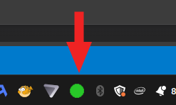
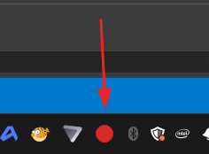
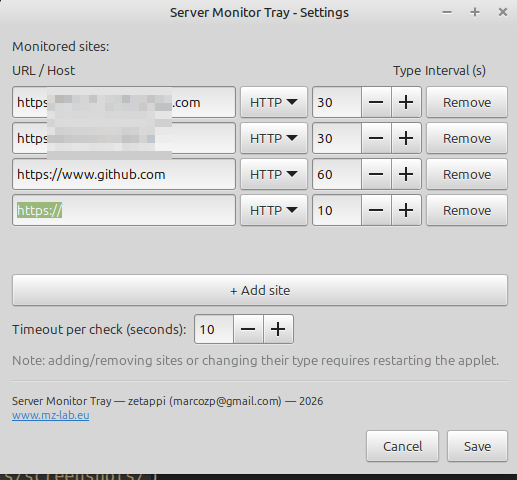

*[English version here](README.md)*

# Server Monitor Tray

Un'applet nativa e leggera per Linux, scritta in Rust, per tenere d'occhio i tuoi siti e server. Gira silenziosamente in background, controlla ogni sito con il proprio intervallo via HTTP o ping, e fa diventare rossa l'icona in tray — con tanto di popup desktop — nel momento in cui qualcosa va giù, così non devi tenere una scheda del browser aperta né aspettare che sia qualcun altro ad avvisarti che il tuo sito è offline.

## Screenshot

| Online | Offline | Impostazioni |
|---|---|---|
|  |  |  |

## Funzionalità

- Monitoraggio di più siti/host in parallelo, ciascuno con intervallo di controllo indipendente
- Due tipi di controllo per sito: **HTTP** (richiesta GET) o **Ping** (ICMP via comando di sistema `ping`)
- Icona verde quando tutti i siti sono raggiungibili, icona rossa lampeggiante se almeno uno è offline
- Tooltip con l'elenco di tutti i siti e il loro stato
- Click sinistro sull'icona: finestra con lo stato dettagliato di ogni sito
- Click destro sull'icona: menu con "Impostazioni..." (aggiungi/rimuovi siti, cambia tipo di controllo e intervallo) ed "Esci"
- Al salvataggio delle impostazioni l'applet si riavvia automaticamente applicando subito la nuova configurazione

## Requisiti

- Rust (edizione 2024, toolchain stabile recente)
- GTK3 (librerie di sviluppo): su Debian/Ubuntu `sudo apt install libgtk-3-dev`
- Un desktop con supporto a system tray via StatusNotifierItem (es. GNOME con estensione tray, KDE, Cinnamon, XFCE)
- Il comando `ping` di sistema presente in `PATH` (per i controlli di tipo Ping)
- `notify-send` presente in `PATH` (incluso in `libnotify-bin` su Debian/Ubuntu), per le notifiche desktop sui cambi di stato

## Installazione (consigliata)

Lo script `install.sh` compila il progetto e installa l'applet come una vera applicazione del sistema:

```bash
./install.sh
```

Cosa fa, nello specifico:

- Compila in release (`cargo build --release`)
- Copia il binario in `~/.local/bin/server-monitor-tray`
- Copia l'icona in `~/.local/share/icons/hicolor/128x128/apps/`
- Crea un config di default in `~/.config/server-monitor-tray/watchdog.conf` (solo se non esiste già — non sovrascrive un config esistente)
- Crea un file `.desktop` in `~/.local/share/applications/`, così l'app compare nel menu applicazioni con nome e icona propri
- Copia lo stesso `.desktop` in `~/.config/autostart/`, così l'app parte automaticamente ad ogni login

Dopo l'installazione:

- Cerca **"Server Monitor Tray"** nel menu applicazioni per lanciarla manualmente, oppure
- Fai logout/login (o riavvia) perché parta in autostart, oppure
- Lanciala subito a mano con `~/.local/bin/server-monitor-tray ~/.config/server-monitor-tray/watchdog.conf`

Per modificare i siti monitorati in seguito, usa il menu "Impostazioni..." dal click destro sull'icona in tray — non serve rieseguire `install.sh` a meno di aver aggiornato il codice.

### Aggiornare dopo una modifica al codice

```bash
cargo build --release
cp target/release/watchdog ~/.local/bin/server-monitor-tray
```

(oppure semplicemente rilancia `./install.sh`, che non toccherà il tuo config esistente)

### Disinstallazione

```bash
rm ~/.local/bin/server-monitor-tray
rm ~/.local/share/icons/hicolor/128x128/apps/server-monitor-tray.png
rm ~/.local/share/applications/server-monitor-tray.desktop
rm ~/.config/autostart/server-monitor-tray.desktop
rm -r ~/.config/server-monitor-tray   # rimuove anche il tuo config personalizzato
```

## Build manuale (senza installazione)

```bash
cargo build --release
./target/release/watchdog [percorso/al/config.conf]
```

Se non specificato, viene usato `watchdog.conf` nella directory corrente. Un file di esempio è fornito in [`watchdog.conf.example`](watchdog.conf.example) — copialo in `watchdog.conf` e personalizzalo.

## Formato del file di configurazione

```ini
site1_url = https://example.com
site1_type = http
site1_interval_secs = 10

site2_url = example.com
site2_type = ping
site2_interval_secs = 15

timeout_secs = 5
```

- `siteN_url`: URL (per `http`) o host/IP (per `ping`) del sito N. Lo schema `http(s)://` viene ignorato automaticamente nei controlli ping.
- `siteN_type`: `http` oppure `ping`.
- `siteN_interval_secs`: intervallo in secondi tra due controlli di quel sito.
- `timeout_secs`: timeout (in secondi) applicato a tutti i controlli, modificabile anche a caldo dalle Impostazioni.

Il file può essere modificato anche a mano; i numeri `N` devono essere consecutivi a partire da 1.

## Licenza

MIT
